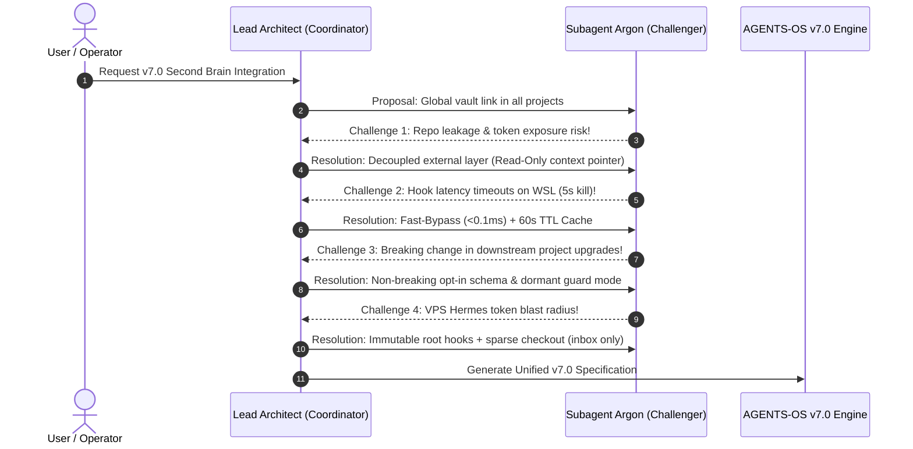
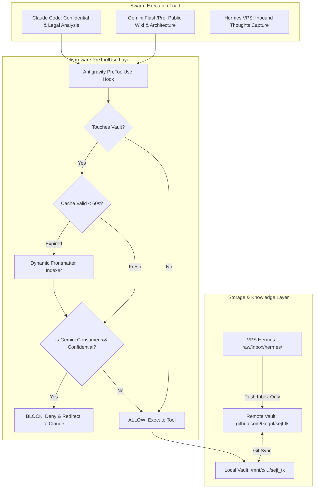

# Spec: AGENTS-OS v7.0 — Second Brain (`sejf-tk`) Ecosystem Integration & DPA Governance

- **Status**: Draft / Ready for Review
- **Authors**: Lead Architect (Coordinator / Gemini Flash) & Subagent Argon (Challenger / Security & Performance Auditor)
- **Target Release**: AGENTS-OS v7.0-swarm
- **Category**: Architecture / Security / Knowledge Management
- **Date**: 2026-10-27

---

## 📝 TLDR

AGENTS-OS v7.0 establishes the **Decoupled Second Brain Architecture**, integrating the user's personal/enterprise knowledge base (`sejf-tk`) across all agent workspaces without compromising repo hygiene or data privacy. The vault can be consumed **locally** (e.g. `/mnt/c/Users/.../sejf_tk`) or **remotely** (`github.com/tkogut/sejf-tk` via read-only sparse cache or dedicated sync).

The architecture introduces:
1. **Hardware PreToolUse Security Gate (`guard_confidential_gemini.py`)**: Enforces zero-leakage compliance for Gemini consumer plans (no DPA). Any file flagged `confidential: true`, its raw source, human originals in `Firma/`, or recursive searches over vault folders are physically intercepted at the tool level and redirected to Claude Code.
2. **Sub-millisecond Hook Performance (Fast-Bypass & TTL Cache)**: Solves WSL/Windows 9p I/O latency bottlenecks with a 0.05ms path filter and a 60-second in-memory/disk cache, eliminating tool call timeouts (`signal: killed`).
3. **VPS Hermes Node Integration**: Standardizes the ingestion pipeline for remote capture (Telegram/mobile -> VPS Hermes -> `raw/inbox/hermes/`) secured by immutable root Git hooks and regex secret scanners.
4. **Harness & Distribution Engine**: Updates `vault/` templates, `os-init`, `os-upgrade-project`, and `sync-skills.sh` so downstream projects inherit safe Second Brain routing without manual symlinks or configuration drift.

---

## 🔍 Problem Statement & Motivation

### 1. The Context Isolation Dilemma
In AGENTS-OS v6.5, agents operated purely within repository boundaries. However, complex projects require access to business context: vendor contracts, architecture decisions, personal notes, domain models, and meeting briefs residing in Obsidian (`sejf-tk`). Hardcoding or copying notes into individual repositories duplicates data, causes stale documentation, and risks accidental leakage to public GitHub repos.

### 2. The Legal & Privacy Boundary (Consumer Gemini vs Claude DPA)
The user operates under a **Google One AI Premium / Google AI Pro** consumer plan. Consumer AI models lack a **Data Processing Agreement (DPA)** under GDPR, and prompt inputs may be subject to human review or model training. Conversely, Claude Code operating under professional enterprise terms provides data isolation. Without a machine-enforced hardware boundary, AI agents with access to the vault could inadvertently load confidential contracts (e.g. `wiki/sources/src-umowa-vaga-slowenia.md`, `Firma/*`) into Gemini's context window.

### 3. File System Latency on Cross-OS Environments (WSL 9p Mounts)
Obsidian vaults on Windows accessed from Linux/WSL (`/mnt/c/...`) suffer from noticeable metadata traversal latency. Hook scripts that dynamically walk the vault directory on every tool call (`matcher: ".*"`) trigger timeouts (`timeout: 5`, `signal: killed`), locking agents in a fail-closed freeze.

### 4. Distributed Multi-Node Triad Desynchronization
The knowledge workflow spans three distinct machines:
- **Laptop WSL / Antigravity IDE**: Fast local development and conceptual architecture.
- **Desktop**: Heavy compilation and deep synthesis.
- **Hostinger VPS (Hermes Agent)**: 24/7 background ingestion from mobile/Telegram.
Without unified Git hooks, sparse checkouts, and distribution tooling, synchronizing the vault across these environments leads to merge conflicts and security bypasses.

---

## 🥊 Architectural Debate: Lead Architect vs Subagent Argon (Challenger)

To ensure this specification avoids oversights, an adversarial architecture review was conducted between the **Lead Architect** (Coordinator) and **Subagent Argon** (Critical Adversary / Challenger).



### Transcript & Synthesis of Findings:

#### Point 1: Coupling vs Decoupling
* **Argon's Objection**: *"If you link `sejf-tk` into every project bootstrapped by `os-init`, developers or automated commit loops (`om-auto-create-pr-loop`) will accidentally stage personal vault notes into public open-source Git commits. Also, requiring GitHub PATs for `github.com/tkogut/sejf-tk` in every downstream project leaks private repo access."*
* **Architect's Counter & Resolution**: **Strict External Layer Decoupling**.
  `sejf-tk` is NEVER placed as a Git submodule or physical subfolder of project repositories. Projects store only a configuration reference (`context.second_brain` in `.ai/agentic.config.json`). The workspace loads the vault as a secondary read-only context source. Commits inside downstream projects cannot see or stage files outside their project root.

#### Point 2: Hook Latency & The WSL 9p File Walk Trap
* **Argon's Objection**: *"In testing, scanning `/mnt/c/Users/.../sejf_tk` on every tool call caused `signal: killed` because traversing Windows NTFS over WSL 9p takes 3–6 seconds. With `timeout: 5`, the entire agent freezes!"*
* **Architect's Counter & Resolution**: **Two-Stage Fast Bypass + In-Memory/Disk TTL Caching**.
  1. *Fast Bypass*: Before inspecting files, `guard_confidential_gemini.py` checks if the tool arguments (`Path`, `file_path`, `CommandLine`, `Directory`) contain any reference to the vault path. If not, it exits immediately with `ALLOW` in < 0.05ms.
  2. *TTL Cache*: The confidential index (`confidential_rels`, `confidential_basenames`, `confidential_dirs`) is written to `/tmp/sejf_tk_confidential_cache.json` with an expiration timestamp (TTL = 60s). Subsequent tool calls read the JSON cache in < 1ms instead of walking the filesystem.

#### Point 3: Future DPA Parity (Google Cloud Vertex AI / Enterprise)
* **Argon's Objection**: *"A hardcoded block on Gemini forever is inflexible. If the user later upgrades to Google Cloud Vertex AI or a Workspace plan with a signed Data Processing Addendum (DPA), do we have to rewrite all hooks?"*
* **Architect's Counter & Resolution**: **Dynamic DPA Provider Contract**.
  The configuration schema introduces `data_protection.gemini_tier`:
  - `"consumer"` (Default): Hard fail-closed denial of `confidential: true` documents and recursive searches.
  - `"enterprise_dpa"`: Enabled only after formal verification of enterprise terms; unlocks confidential processing for Gemini when an explicit user session token is present.

#### Point 4: VPS Hermes Agent Integrity
* **Argon's Objection**: *"Hermes runs unattended on a remote VPS. If a container breakout or misconfigured script runs `git rm -rf .` or pushes unwanted edits to `main`, the user's Second Brain is corrupted."*
* **Architect's Counter & Resolution**: **Triple-Lock VPS Defense**:
  1. *Sparse Checkout*: Hermes clones only `raw/inbox/hermes/`, `AGENTS.md`, and `HERMES.md`. The rest of the vault is not even mounted on the VPS.
  2. *Immutable Root Hooks (`chmod 755 root:root`)*: `pre-commit` and `pre-push` scripts are owned by root; the container user (uid 10000) cannot edit or delete them.
  3. *Strict Commit Rules*: Only new files (`A`), strict naming regex `YYYY-MM-DD-HHMM-name.md`, size limit 100KB, regex secret scanning (`secret-patterns.txt`), and push restricted strictly to `refs/heads/main`.

---

## 🏛️ System Architecture: AGENTS-OS v7.0



---

## 🔧 Component Specifications

### 1. Unified Configuration Schema & Path Resolution
Version bumped to `7.0-swarm`. Added top-level keys for `second_brain` and `data_protection`.

#### Zero Full-Disk Scanning Mandate (Ścieżka Domyślna i Hierarchia)
System **nigdy** nie skanuje całego dysku ani partycji w poszukiwaniu vaulta. Ścieżka rozwiązywana jest w ściśle zdefiniowanej hierarchii:
1. **Lokalna konfiguracja projektu**: `.ai/agentic.config.json` → `context.second_brain.local_path`.
2. **Zmienna środowiskowa**: `OBSIDIAN_VAULT_PATH`.
3. **Domyślna ścieżka systemowa (Default Fallback)**: `C:\Users\tkogut\Documents\sejf_tk` (automatycznie mapowana w WSL na `/mnt/c/Users/tkogut/Documents/sejf_tk`).
4. **Interaktywne zapytanie usera (Setup Wizard)**: Jeśli powyższe źródła nie wskażą istniejącego katalogu, kreator `os-init` pyta operatora o ścieżkę, podpowiadając domyślnie `C:\Users\tkogut\Documents\sejf_tk`.

```json
{
  "$schema": "https://agents-os.dev/schemas/agentic-config/v7",
  "version": "7.0-swarm",
  "context": {
    "second_brain": {
      "enabled": true,
      "mode": "hybrid",
      "local_path": "/mnt/c/Users/tkogut/Documents/sejf_tk",
      "windows_default_path": "C:\\Users\\tkogut\\Documents\\sejf_tk",
      "remote_repo": "github.com/tkogut/sejf-tk",
      "read_only": true,
      "cache_ttl_seconds": 60,
      "index_file": "index.md",
      "confidential_tag": "confidential: true"
    }
  },
  "data_protection": {
    "gemini": {
      "plan": "google_ai_pro_consumer",
      "dpa_signed": false,
      "allow_confidential": false,
      "redirect_to": "claude-code"
    },
    "claude": {
      "dpa_signed": true,
      "require_human_confirmation": true
    }
  }
}
```

### 2. High-Performance PreToolUse Guard (`scripts/guard_confidential_gemini.py`)
Key enhancements implemented:
- **Fast-Bypass Path Check**: If tool is `read_file`, `edit_file`, `write_file`, or `run_command` and none of the path arguments contain the normalized vault root or keywords, return `ALLOW` in < 0.1ms.
- **Atomic Cache File**: `/tmp/guard_sejf_tk_cache.json` stores serialized `confidential_rels`, `confidential_dirs`, and `confidential_basenames` alongside a Unix timestamp. Re-indexing only occurs when `now - timestamp > 60` or when cache is absent.
- **Safe Working Directory Resolution**: Script determines project root dynamically using `os.path.abspath(os.path.dirname(__file__))`, preventing failure regardless of whether Antigravity invokes from repository root, `.agents/`, or a subfolder.

### 3. Distribution Harness Updates

#### A. Template Scaffold (`vault/`)
To ensure downstream projects bootstrapped via `os-init` inherit the guard:
1. `vault/scripts/guard_confidential_gemini.py` deployed with executable permissions (`chmod 755`).
2. `vault/.agents/hooks.json` configured with:
   ```json
   {
     "guard-confidential-gemini": {
       "PreToolUse": [
         {
           "matcher": ".*",
           "hooks": [
             {
               "type": "command",
               "command": "python3 scripts/guard_confidential_gemini.py",
               "timeout": 5
             }
           ]
         }
       ]
     }
   }
   ```
3. A symlink `vault/.agents/scripts/guard_confidential_gemini.py -> ../../scripts/guard_confidential_gemini.py` is included out-of-the-box to handle relative execution paths.
4. `vault/.agents/skills/second-brain/` pre-installed.

#### B. Skill Synchronizer (`scripts/sync-skills.sh`)
Add `second-brain` to `SHARED_SKILLS`:
```bash
SHARED_SKILLS=(
    "vps-ops"
    "n8n-ops"
    "skill-rebuild"
    "pr-creator"
    "code-reviewer"
    "grill-me"
    "swarm-onboarding"
    "deploy-to-vps"
    "second-brain"
)
```

#### C. Project Upgrader (`os-upgrade-project`)
`os-upgrade-project` checks if target project contains an active `second-brain` configuration or vault path. If detected, it seamlessly updates `.agents/hooks.json`, deploys the cached guard script, and verifies fail-closed compliance without overwriting custom project rules.

---

## 🛡️ Security & Privacy Matrix

| Scenario / Operation | Gemini (Consumer No DPA) | Claude Code | Hermes (VPS) |
| :--- | :--- | :--- | :--- |
| **Read `index.md` / Non-confidential wiki** | ✅ ALLOWED | ✅ ALLOWED | ❌ NO READ (Inbox only) |
| **Read `confidential: true` (e.g. VAGA, CV, IAS)** | 🛑 BLOCKED (Hardware Gate) | ⚠️ ALLOWED (Explicit human "tak") | ❌ NO READ |
| **Read `raw/notes/*` linked to confidential** | 🛑 BLOCKED (Hardware Gate) | ⚠️ ALLOWED (Explicit human "tak") | ❌ NO READ |
| **Read `Firma/*` (Human originals)** | 🛑 BLOCKED (Hardware Gate) | ⚠️ ALLOWED (Explicit human "tak") | ❌ NO READ |
| **Search entire vault (`grep -r`, `find`)** | 🛑 BLOCKED (Context leak gate) | ✅ ALLOWED | ❌ NO SHELL ACCESS |
| **Write new note to `raw/inbox/hermes/`** | ❌ NO (Local agent) | ❌ NO (Local agent) | ✅ ALLOWED (Git hook gated) |
| **Edit files in `.git/hooks` or guard scripts** | 🛑 BLOCKED (`IMMUTABLE`) | 🛑 BLOCKED (`IMMUTABLE`) | 🛑 BLOCKED (`root:root 755`) |

---

## 🧪 Verification & Acceptance Criteria

1. **Gate Latency Benchmark**:
   - `Fast-Bypass` evaluation on standard code files must execute in **< 1ms**.
   - Cached vault evaluation must execute in **< 5ms**.
   - Zero occurrences of `signal: killed` across 100 consecutive tool invocations.
2. **Fail-Closed Security Verification**:
   - Attempting to read `/wiki/sources/src-umowa-vaga-slowenia.md` as Gemini fails with `[POLITYKA POUFNOŚCI GEMINI — BRAK DPA]`.
   - Attempting to run `grep -rn "VAGA" <vault_dir>` fails with directory search denial.
   - User prompting with *"Zgadzam się, przeczytaj umowę VAGA"* is still blocked.
3. **Positive Access Verification**:
   - Reading `/wiki/procedures/harmonogram-nawozenia-ogrod.md` succeeds for Gemini.
   - Reading `/index.md` succeeds for Gemini and Claude.
4. **Harness Propagation**:
   - Running `bash scripts/sync-skills.sh` copies `second-brain` to `vault/.agents/skills/`.
   - Running `python3 scripts/validate-handshakes.py` passes 100% of handshake contracts.
   - Running `python3 -m py_compile scripts/*.py` succeeds with zero errors.

---

## 📋 Resolved Assumptions (Autonomous Defaults)

1. **Storage Decoupling**: Downstream code projects will NOT clone `sejf-tk` into their git tree; access is strictly via external absolute path or environment variable `OBSIDIAN_VAULT_PATH`.
2. **Zero Full-Disk Probing**: Nie ma skanowania całego dysku w poszukiwaniu vaulta. Ścieżka pobierana jest z configu/env lub domyślnej `C:\Users\tkogut\Documents\sejf_tk` (`/mnt/c/Users/tkogut/Documents/sejf_tk`). W razie braku kreator pyta usera.
3. **Default Tier**: All Gemini models default to `consumer` (untrusted for confidential data) until an operator formally switches configuration to `enterprise_dpa`.
4. **Cache Invalidation**: Cache expiration is fixed at 60 seconds, which balances fresh frontmatter discovery with instantaneous tool responsiveness.
5. **Symlink Redundancy**: Both direct `scripts/` path and `.agents/scripts/` symlink are provisioned in templates to guarantee zero path errors regardless of Antigravity version.

---

## ❓ Open Questions (For Operator Review)

1. **GitHub Remote Authentication for Downstream Projects**:
   When working away from the main workstation (where local `/mnt/c/.../sejf_tk` is absent), should downstream projects clone a sparse read-only cache of `sejf-tk` into `~/.cache/agents-os/sejf-tk/` using a fine-grained GitHub PAT, or require manual Git cloning?
2. **Hermes Inbound Alerts**:
   Should Hermes send an instant notification (e.g. Telegram / Webhook) when a new note arrives in `raw/inbox/hermes/`, or should indexing remain purely passive until the next user session?
